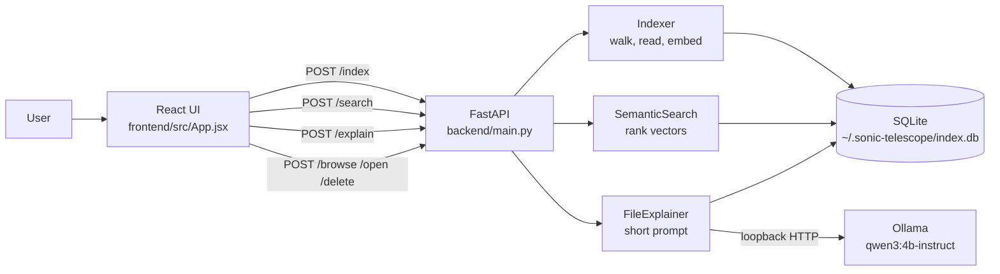
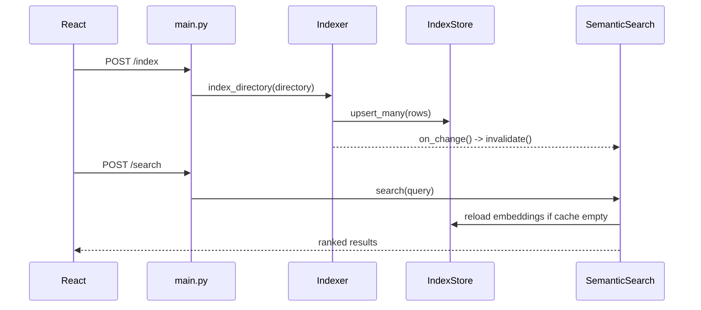
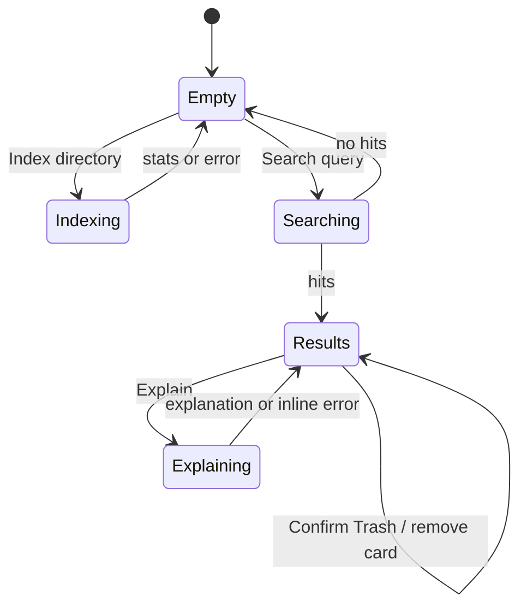

# Sonic Telescope: Code Walkthrough

This is a concise, line-oriented guide to the current Phase 1 implementation. It explains what each source block does, how data moves through the app, and where the important limits and failure paths are.

The references use module names and function names so they remain useful as line numbers change.

## 1. What the app does

Sonic Telescope is a local semantic file library:

1. The user chooses a directory in the React UI.
2. FastAPI walks that directory, extracts a bounded representation of each supported file, creates an embedding, and stores it in SQLite.
3. A natural-language query is embedded with the same text model and compared with stored embeddings using cosine similarity.
4. The UI displays ranked files. An optional explanation sends only metadata and a short excerpt to Ollama on `127.0.0.1`.
5. Open and Trash are secondary actions. Trash is recoverable through the operating system's Trash rather than permanent deletion.



## 2. Startup and module wiring

`backend/main.py:1-33` is the composition root.

- Lines 1-12 import the standard library, Uvicorn, FastAPI, CORS middleware, Pydantic, and the local modules.
- Lines 19-22 create the FastAPI application and describe it as Phase 1.
- The CORS middleware allows the local Vite development origins (`localhost:5173` and `127.0.0.1:5173`). The API binds to loopback when started directly.
- Lines 31-33 create three long-lived objects:
  - `SemanticSearch`, which owns the shared `IndexStore` and its vector cache.
  - `Indexer`, pointed at the same store and given `searcher.invalidate` as its change callback.
  - `FileExplainer`, pointed at the same store.

That shared store and callback are the key connection between indexing and searching:



## 3. Backend, line by line

### `backend/main.py`: HTTP boundary

`main.py:36-59` defines request validation models. Pydantic turns incoming JSON into typed objects and rejects invalid limits before the handlers run:

- `DirectoryRequest` requires `directory`.
- `SearchRequest` requires `query`; `limit` defaults to 20 and is constrained to 1-100.
- `ExplainRequest` requires `path` and accepts an optional Ollama `model` override.
- `DeleteRequest` and `OpenRequest` both carry `file_path`.

`main.py:61-69` implements `GET /health`. It reports the app identity, Phase 1, current indexed-file count, and the configured explain model. It does not load the embedding model, so health stays cheap.

`main.py:72-82` implements `POST /index`:

1. Read the directory from the validated request.
2. Reject a non-directory with HTTP 400.
3. Delegate the work to `Indexer.index_directory`.
4. Convert a bad directory value to HTTP 400 and unexpected failures to HTTP 500.

`main.py:85-91` implements `POST /search`. It delegates to `SemanticSearch.search`, returns the original query, hit count, and result list, and converts unexpected failures to HTTP 500.

`main.py:94-103` implements `POST /explain`:

- With `model`, construct a one-request `FileExplainer` using that model.
- Without it, use the shared explainer.
- Map `ExplainError` to HTTP 503, which tells the UI that the local model service is unavailable or could not answer.
- Map other failures to HTTP 500.

`main.py:106-116` implements `POST /delete`. It calls `trash_path`, returns HTTP 400 on failure, then removes the file or directory and its indexed descendants from SQLite and invalidates the search cache. Store cleanup is best-effort: a database cleanup failure is swallowed after the path has already reached Trash.

`main.py:119-151` contains the macOS folder picker. `_tkinter_worker` creates a hidden, topmost Tk window, opens `askdirectory`, destroys the window, and puts the selected path into a multiprocessing queue. `browse_directory_process` runs that UI in a child process, waits up to 60 seconds, and returns `{"path": ""}` on cancel, timeout, or error.

`main.py:153-163` implements `POST /open`. It checks that the path exists, invokes macOS `open` through `subprocess.run(check=True)`, and returns HTTP 404 or 500 when appropriate.

`main.py:166-167` starts Uvicorn only when the file is run directly, on `127.0.0.1:8000`.

### `backend/index_store.py`: durable local state

`index_store.py:9-10` chooses `~/.sonic-telescope/index.db` as the default database. `index_store.py:12-25` defines the SQLite upsert statement. `path` is the conflict key, so re-indexing a changed file replaces its metadata and embedding instead of adding a second row.

`index_store.py:27-33` chooses the default or supplied database path, creates its parent directory, and initializes the schema.

`index_store.py:35-38` opens SQLite connections with `sqlite3.Row`, allowing callers to access columns by name.

`index_store.py:40-57` creates the `files` table and an mtime index:

| Column | Meaning |
| --- | --- |
| `path` | Absolute path and primary key |
| `mtime`, `size` | File-change fingerprint |
| `mime` | Guessed MIME type |
| `text_excerpt` | At most 800 characters kept for display/explain |
| `embedding` | Float32 vector serialized as a BLOB |
| `embedding_dim` | Vector length used to validate the BLOB |
| `last_indexed` | Index timestamp |

`index_store.py:59-68` provides `get` for one file and `meta_map` for the cheap path-to-`(mtime, size)` lookup used during indexing.

`index_store.py:70-88` converts row dictionaries into SQL parameters, does nothing for an empty batch, and commits one `executemany` transaction.

`index_store.py:90-105` deletes one path, loads all rows that have embeddings, and counts all stored rows. Each operation opens and closes its own connection through a context manager.

### `backend/indexer.py`: walk, filter, and embed

`indexer.py:16-18` sets the main safety bounds: files larger than 8 MiB are ignored, text read is capped at 4,000 characters, and display/explain excerpts are capped at 800 characters.

`indexer.py:19-31` lists directories that are never traversed, including `.git`, `node_modules`, caches, build output, and the app's own data directory.

`indexer.py:32-72` classifies extensions as text or image. Unknown files are still indexed as a filename label, provided they pass the size and non-empty checks.

`indexer.py:75-77` reads only the first `MAX_TEXT_CHARS` bytes-as-decoded characters, using UTF-8 and ignoring undecodable bytes.

`indexer.py:80-88` loads the shared text model, encodes a batch of up to the caller-provided items with batch size 32, converts the result to float32, and reshapes a single vector to two dimensions.

`indexer.py:91-100` constructs an indexer with an optional store and optional change callback.

`indexer.py:102-156` is the top-level indexing algorithm:

1. Resolve and validate the root directory.
2. Load existing `(mtime, size)` values from SQLite.
3. Walk the tree while pruning hidden directories and `SKIP_DIR_NAMES` in-place.
4. Skip hidden files, unchanged files, invalid files, and files that raise collection errors.
5. Embed the remaining items in one batch.
6. Upsert generated rows and remove indexed paths beneath the selected root only when the filesystem confirms they are missing. Permission and other ambiguous filesystem errors preserve rows.
7. Invalidate the search cache when rows are added, updated, or removed, then return counts including removed rows. The error list is truncated to 50 while the full error count is preserved.

`indexer.py:158-189` collects one file's metadata. It rejects stat failures, directories, empty files, and files over 8 MiB. It resolves the path, compares mtime within a 1 ms tolerance plus exact size, guesses MIME type, and assigns `text`, `image`, or `other`.

`indexer.py:191-219` prepares embedding text. Text files contribute their prefix, images contribute `image_file_label`, and other files contribute `File named <name>`. Blank text and per-file read/classification failures are skipped without aborting the whole directory.

`_rows_from_batch` turns each `(metadata, text)` pair into a database row. It stores the first 800 characters, serializes the float32 embedding with NumPy `tobytes`, records its dimension, and uses one `time.time()` value for the batch timestamp.

```mermaid
flowchart TD
    W[os.walk(root)] --> F{file passes filters?}
    F -- no --> SK[skipped count]
    F -- yes --> C{kind}
    C -- text --> T[read <= 4000 chars]
    C -- image --> I[filename label or optional CLIP label]
    C -- other --> O[filename label]
    T --> E[SentenceTransformer encode]
    I --> E
    O --> E
    E --> R[row: metadata + <=800-char excerpt + float32 blob]
    R --> DB[(SQLite upsert by absolute path)]
```

### `backend/models.py`: lazy model singletons

`models.py:8-12` names the text and optional image models and initializes process-local caches.

`models.py:15-16` enables CLIP only when `SONIC_ENABLE_CLIP` is `1`, `true`, or `yes`, case-insensitively.

`models.py:19-27` imports `sentence_transformers` only on the first text-model request, loads `all-MiniLM-L6-v2`, caches it, and returns the same object thereafter. This keeps `/health` and app startup from loading Torch unnecessarily.

`models.py:30-37` does the same for `clip-ViT-B-32`, but only when an image needs CLIP labeling.

`models.py:40-65` creates an image search label. The default is the filename. With CLIP enabled, it opens the image, embeds it and six fixed category prompts, picks the prompt with the highest cosine similarity, and returns a category plus filename. Any CLIP/PIL failure falls back to the filename label.

### `backend/search.py`: vector ranking and cache

`search.py:13-19` creates a searcher with the shared store and two empty caches: a normalized matrix and matching metadata.

`search.py:21-23` clears both caches. Indexing and deletion call this so a later query sees current SQLite data.

`search.py:25-65` lazily builds the cache. It loads rows with embeddings, validates each BLOB's dimension, drops malformed or zero-length vectors, normalizes each vector, and stores matching display metadata. The matrix has one row per file and one column per embedding dimension.

`search.py:67-100` performs a query:

1. Trim the query and return no hits for empty input.
2. Clamp `limit` to 1-100.
3. Ensure the matrix cache exists.
4. Encode and normalize the query with the same text model.
5. Return no hits if the dimension does not match the stored matrix.
6. Compute `matrix @ q`; because both sides are normalized, each dot product is cosine similarity.
7. Use a full sort for all rows or `argpartition` followed by a small sort for top-k.
8. Add a rounded score to each metadata record.

```text
normalized file vectors:  [v1]
                           [v2]  @ normalized query q  -> scores -> top k
                           [v3]
```

### `backend/explain.py`: bounded local explanation

`explain.py:13-15` fixes Ollama to loopback, selects `SONIC_EXPLAIN_MODEL` or `qwen3:4b-instruct`, and caps the model excerpt at 600 characters.

`explain.py:18-20` defines `ExplainError`, the fail-closed error type exposed as HTTP 503 by the API.

`explain.py:22-33` defines `FileExplainer`, which uses an injected store, model, and base URL, defaulting to the local settings.

`explain.py:35-52` resolves the requested path and loads indexed metadata. If the file is not indexed, it checks that the file exists and obtains size/mtime directly. It never reads the whole file at explain time.

`explain.py:53-67` builds a prompt from basename, absolute path, MIME type, size, mtime, and at most 600 excerpt characters. The instructions tell Ollama to stay grounded and admit uncertainty.

`explain.py:69-83` calls Ollama and returns the normalized response plus the path, model, and number of excerpt characters used.

`explain.py:85-122` posts to `/api/generate` with streaming and thinking disabled, low temperature, a 2,048-token context, and 256 predicted tokens. It rejects non-200 responses and empty responses, and translates connection, timeout, and other HTTP errors into useful `ExplainError` messages.

### `backend/actions.py`, `agent.py`, and `organize.py`

`actions.py:6-16` implements `trash_path`. It verifies that the path exists and is a regular file or directory, calls `send2trash`, and returns `(success, message)` instead of raising to the API layer.

`agent.py:1` is intentionally only a Phase 2 cleanup-agent stub. It has no proposal or confirmation behavior yet.

`organize.py` is the Phase 3 organizer stub. It is reserved for previewable move plans and confirmed application of those plans.

## 4. Frontend, line by line

### `frontend/src/main.jsx`

`main.jsx:1-4` imports React's `StrictMode`, ReactDOM's root API, global CSS, and `App`.

`main.jsx:6-10` finds `<div id="root">` from `frontend/index.html` and renders `<App />` inside `StrictMode`, which helps React surface unsafe development patterns.

### `frontend/src/App.jsx`

`App.jsx:1-5` imports `useState`, Axios, and component CSS. `API_URL` points the Vite page to FastAPI on port 8000.

`App.jsx:7-12` centralizes error-detail extraction and JSON POST requests.

`App.jsx:15-20` formats byte counts into B, KB, MB, or GB with one decimal place. A zero-like value becomes `0 B`.

`App.jsx:22-32` declares the component's state: selected directory, query, results, indexing-error count, explanations keyed by path, action loading state, per-path explanation loading state, and separate error/status messages.

`App.jsx:34-41` handles Browse. It calls `/browse` and copies a non-empty returned path into the directory input; failures use an alert.

`App.jsx:43-60` handles Index. It refuses an empty directory, sets loading state, posts `{ directory }`, stores returned stats, builds the status sentence, reports errors, and always clears loading in `finally`.

`App.jsx:62-77` handles Search. It prevents form navigation, rejects blank queries, posts a trimmed query with limit 20, replaces results, sets a found/no-match status, and always clears the searching state.

`App.jsx:79-93` handles Explain. It tracks each path independently while requests are running, posts `{ path }`, stores only the returned explanation under that path, displays a readable inline failure when Ollama is unavailable, and clears that path's loading marker.

`App.jsx:95-101` handles Open by posting `{ file_path }` to `/open`; failures use an alert.

`App.jsx:103-111` handles Trash. It requires `window.confirm`, posts to `/delete`, removes the successful result from local state, and alerts on failure.

`App.jsx:113-127` renders the shell, decorative background orbs, title, tagline, and Phase 1 badge.

`App.jsx:129-162` renders the two primary controls: folder indexing with text input, Browse, and Index; and search with a form input and Search button. Buttons disable themselves while work is running or when their required input is absent.

`App.jsx:164-170` renders an error banner, a status banner, and a warning when the index response reports file-level errors.

`App.jsx:172-217` renders results. Empty results show the onboarding message. Otherwise each path becomes a stable-key card containing filename, score, MIME, formatted size, snippet, match reasons, full path, optional explanation, and Explain/Open/Trash actions.

`App.jsx:219-225` renders the local-only privacy footer and closes/exports the component.



### `frontend/index.html`, `vite.config.js`, and CSS

`frontend/index.html:1-12` supplies the HTML shell, viewport metadata, page title, root element, and Vite module entry. The Vite favicon link has been removed in the current working tree.

`frontend/vite.config.js:1-7` imports Vite's config helper and React plugin, then exports the minimal plugin configuration.

`frontend/src/index.css:1-29` applies border-box sizing, full-height root layout, a responsive minimum width, the system font stack, antialiasing, dark color scheme, and inherited font settings for controls.

`frontend/src/App.css` is visual-only and does not change data flow:

- Lines 1-27 define the dark aurora palette, glass surfaces, borders, shadows, and radii.
- Lines 29-99 define the animated shell and three decorative blurred orbs, with reduced-motion handling at 593-595.
- Lines 101-236 define the centered container, header, logo, title, phase badge, and panel layout.
- Lines 239-352 style inputs and action buttons, including disabled and active states.
- Lines 354-433 style error/status banners and the empty state.
- Lines 434-560 style result cards, metadata badges, snippets, explanation blocks, and action groups.
- Lines 562-578 style the privacy footer.
- Lines 580-595 add tablet/mobile layout changes and the reduced-motion fallback.

## 5. One complete example

For a query such as `tax documents from 2023`, the path is:

```text
React handleSearch
  -> POST http://localhost:8000/search {query, limit: 20}
  -> main.semantic_search
  -> SemanticSearch.search
  -> all-MiniLM-L6-v2.encode(query)
  -> normalized stored matrix @ normalized query
  -> sorted {path, filename, snippet, score, ...}
  -> React setResults
  -> file cards in the Results section
```

Clicking Explain then sends the selected path to FastAPI. The explainer reads only the indexed row's short excerpt and metadata, calls local Ollama, and returns text that React stores in `explanations[path]`. The full file is not sent to Ollama.

## 6. Important boundaries and current gaps

- The backend binds to loopback and allows the two local Vite development origins (`main.py` CORS configuration).
- The default image representation is a filename label. CLIP is opt-in and categorizes against six fixed prompts.
- Re-indexing detects changes by mtime and size, not by content hash.
- Each successful directory index removes catalog rows for confirmed-missing paths beneath that selected root and reports the removal count. Indexing one root does not prune other roots, and reconciliation never deletes files from disk.
- `POST /delete` uses an OS Trash operation, but its response status is named `deleted` for API compatibility.
- Cleanup proposals and organizer move plans are stubs, not implemented features.
- Focused tests cover stale-index reconciliation without loading the embedding model and run with `python3 -m unittest discover -s tests -p 'test_index_reconciliation.py'`. Full test discovery currently fails during import because `tests/test_surface.py` imports action helpers that are not present in `backend/actions.py`. Frontend checks are `npm run lint` and `npm run build` from `frontend`.

## 7. Where to read next

- Product intent and architectural decisions: [`REDESIGN.md`](../REDESIGN.md)
- Setup and API quick reference: [`README.md`](../README.md)
- Backend entrypoint: [`backend/main.py`](../backend/main.py)
- Frontend entrypoint: [`frontend/src/App.jsx`](../frontend/src/App.jsx)
